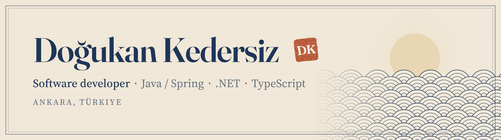

<picture>
  <source media="(prefers-color-scheme: dark)" srcset="assets/banner-dark.png">
  
</picture>

Hi 👋 I'm a Computer Engineering graduate (Selçuk University, 2026) with three internships behind me, the
latest being 7 months on a Scrum team at Yapı Kredi.

I mostly work on the back end (Java / Spring Boot, C# / ASP.NET Core) and build full-stack projects with
React and Next.js. **Open to junior and entry-level roles.**

<picture>
  <source media="(prefers-color-scheme: dark)" srcset="assets/h-projects-dark.png">
  
</picture>

**[underquiz](https://underquiz.dogukankedersiz.dev)** · Next.js · TypeScript · Zod · Vitest\
A level assessment for junior back-end developers. Instead of a single score, it shows your level (1–4) in
each topic and what to study next. Every wrong option maps to a real misconception, and the results page
tells you which one your answer suggests. **Live.**

**[e-commerce](https://github.com/DKedersiz/e-commerce)** · Spring Boot 3 · Next.js 14 · Kafka · Redis · PostgreSQL · Stripe · Docker\
An event-driven store. Order and payment events go through Kafka, products are cached in Redis, Stripe
webhooks confirm payments and Gemini suggests products. The whole stack starts locally with Docker Compose.
[Demo video](https://www.youtube.com/watch?v=2ihhQvjJK9E)

**[Hospital appointment chatbot](https://github.com/DKedersiz/chatbot-appointment-backend-v2)** · Spring Boot · React · TypeScript · PostgreSQL · Gemini\
Patients book appointments by chatting with a Gemini-powered bot.\
[Back end](https://github.com/DKedersiz/chatbot-appointment-backend-v2) ·
[Front end](https://github.com/DKedersiz/chatbot-appointment-frontend-v2)

<picture>
  <source media="(prefers-color-scheme: dark)" srcset="assets/h-tech-dark.png">
  
</picture>

- **Back end:** Java, Spring Boot, JPA / Hibernate, C#, ASP.NET Core, EF Core
- **Front end:** TypeScript, React, Next.js
- **Data and messaging:** PostgreSQL, MySQL, Redis, Kafka
- **Tools:** Docker, Git, Jira

<picture>
  <source media="(prefers-color-scheme: dark)" srcset="assets/h-contact-dark.png">
  
</picture>

[LinkedIn](https://www.linkedin.com/in/dogukankedersiz/)
